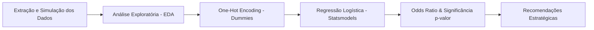
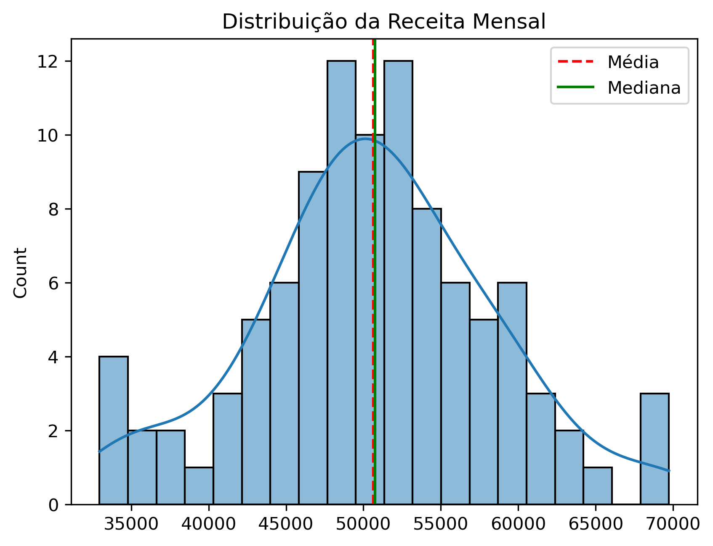

# 📊 Análise Preditiva de Churn de Clientes — Connecta Telecom


Projeto de Ciência de Dados e Modelagem Estatística com foco na identificação dos fatores determinantes do cancelamento de clientes (*churn*) na empresa de telecomunicações **Connecta Telecom**.

---

## 📌 Contexto e Problema de Negócio

A perda de clientes (*churn*) é um dos maiores desafios no setor de telecomunicações, reduzindo a receita recorrente e elevando os custos de aquisição (CAC).

O objetivo deste projeto é:
1. **Identificar o perfil de cliente mais propenso ao cancelamento** através de Análise Exploratória de Dados (EDA).
2. **Quantificar o impacto de variáveis contratuais, temporais e financeiras** na probabilidade de cancelamento usando **Regressão Logística**.
3. **Calcular e interpretar a Razão de Chances (*Odds Ratio*)** para traduzir coeficientes estatísticos em insights claros para a tomada de decisão.
4. **Propor recomendações estratégicas acionáveis** para o time de retenção e atendimento.

---

## 🔬 Metodologia & Pipeline



1. **Extração de Dados:** Base de 2.000 clientes com variáveis de negócio (tempo de fidelidade, tipo de contrato, serviço de internet, valor da fatura e status de churn).
2. **EDA Interativa:** Visualizações com Seaborn, Matplotlib e gráficos interativos com Plotly.
3. **Engenharia de Variáveis:** Criação de variáveis *dummy* (One-Hot Encoding) para alimentar o modelo estatístico.
4. **Modelagem Estatística:** Ajuste de Regressão Logística Binária via `statsmodels.api.Logit`.
5. **Avaliação dos Coeficientes:** Interpretação da Razão de Chances ($\text{Odds Ratio} = e^{\beta}$) e intervalos de confiança a 95%.

---

## 📈 Distribuição da Receita

Abaixo, a distribuição da receita mensal simulada no estudo com as respectivas métricas de tendência central:

<p align="center">
  
</p>

---

## 🔍 Principais Descobertas (Odds Ratio)

A interpretação da **Razão de Chances (*Odds Ratio*)** revelou o impacto relativo de cada variável sobre o cancelamento:

| Variável | Odds Ratio | Impacto no Churn | Interpretação para o Negócio |
| :--- | :---: | :---: | :--- |
| **Tipo de Contrato: Mensal** | **195.18** | 🚨 **Altíssimo Risco** | Clientes com contrato mensal possuem **~195 vezes mais chances de churn** do que clientes com contratos longos. |
| **Serviço de Internet: Fibra Óptica** | **4.28** | ⚠️ **Alto Risco** | Usuários de fibra têm **4,28 vezes mais chances de cancelamento** comparados a usuários de DSL. |
| **Fatura Mensal** | **1.032** | 📈 **Risco Moderado** | Cada R$ 1,00 adicional na fatura aumenta em **3,2%** a probabilidade de cancelamento. |
| **Fidelidade (Meses)** | **0.946** | 🛡️ **Fator Protetor** | Cada mês adicional de permanência reduz em **~5,4%** a chance de churn. |
| **Tipo de Contrato: Dois anos** | **0.280** | 🛡️ **Fator Protetor** | Reduz drasticamente a taxa de cancelamento, sendo o principal amortecedor de churn. |

> **Perfil de Alto Risco:** Cliente recente, com contrato mês a mês, fatura mensal elevada e assinante de Fibra Óptica.

---

## 💡 Recomendações Estratégicas

Com base nos dados e no modelo estatístico, foram definidas 4 ações práticas para a gestão da Connecta Telecom:

1. **Incentivo à Migração de Contratos:**
   - Criar campanhas atrativas para converter clientes do plano mensal para planos anuais ou bienais (oferta de benefícios, descontos iniciais ou upgrades de velocidade).
2. **Plano de Onboarding e Retenção Precoce:**
   - Como cada mês inicial reduz o churn em ~5,4%, estruturar um acompanhamento intensivo e suporte proativo nos primeiros 6 meses de contrato.
3. **Revisão da Percepção de Valor em Faturas Elevadas:**
   - Realizar pesquisas de elasticidade de preço e oferecer benefícios adicionais para clientes com tíquete mais alto, reduzindo a sensação de sobrepreço.
4. **Auditoria Técnica no Serviço de Fibra Óptica:**
   - Investigar a causa das 4x maiores chances de cancelamento na fibra: verificar estabilidade de sinal, velocidade real entregue e tempo de resposta do suporte técnico.

---

## 🛠️ Tecnologias Utilizadas

- **Linguagem:** Python 3.14
- **Gerenciador de Ambientes & Pacotes:** [Astral uv](https://docs.astral.sh/uv/)
- **Manipulação & Análise de Dados:** `pandas`, `numpy`
- **Modelagem Estatística:** `statsmodels`
- **Visualização de Dados:** `matplotlib`, `seaborn`, `plotly`
- **Ambiente Interativo:** `ipykernel`, `nbformat`, Jupyter Notebook

---

## 🚀 Como Executar o Projeto Localmente

Este projeto utiliza o **[uv](https://github.com/astral-sh/uv)** para um gerenciamento de dependências rápido e reprodutível.

### 1. Clonar o repositório
```bash
git clone https://github.com/LucasBorbaDS/analise-churn-clientes.git
cd analise-churn-clientes
```

### 2. Instalar as dependências com o uv
O `uv` criará automaticamente o ambiente virtual (`.venv`) e instalará as versões exatas a partir do lockfile:
```bash
uv sync
```

### 3. Executar o Jupyter Notebook
Abra o notebook no seu editor / IDE selecionando o kernel do `.venv`, ou inicie via terminal:
```bash
uv run jupyter lab
```
Abra o arquivo [`MiniProjeto5.ipynb`](MiniProjeto5.ipynb) e execute as células.

---

## 📁 Estrutura do Repositório

```text
├── .gitignore               # Configurações de arquivos ignorados no Git
├── .python-version          # Versão do Python utilizada pelo uv
├── Analise-de-churn.ipynb       # Notebook principal com EDA, Modelagem e Relatório
├── Analise-de-churn.html        # Exportação estática do notebook
├── meu_grafico_receita.png  # Gráfico da distribuição da receita mensal
├── pyproject.toml           # Configurações do projeto e dependências
├── uv.lock                  # Lockfile com hashes das dependências sincronizadas
└── README.md                # Documentação completa do projeto
```

---

## 👤 Autor

Desenvolvido por **Lucas Borba**.  
- **Email:** [borbalucas33@gmail.com](mailto:borbalucas33@gmail.com)
- **GitHub:** [@LucasBorbaDS](https://github.com/LucasBorbaDS)
